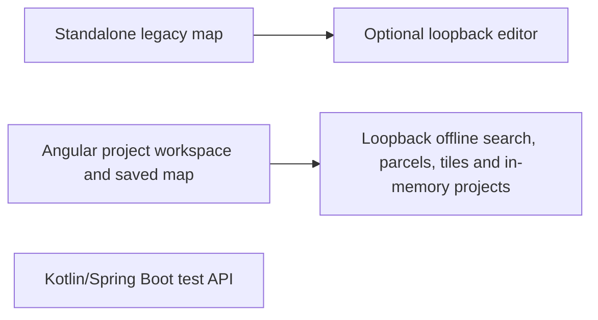
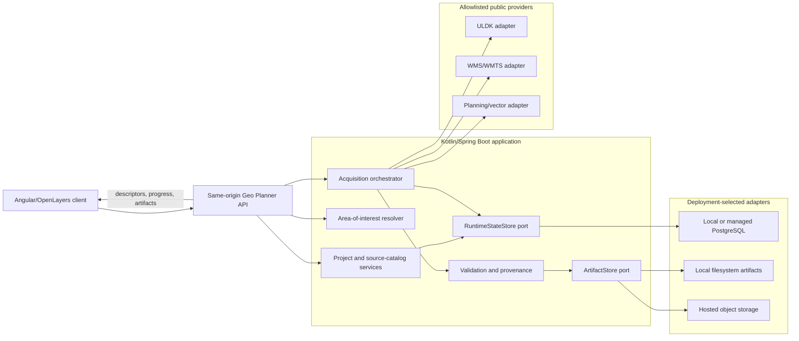

# Target Product Architecture

## Status And Scope

This document is the entry point for accepted target system boundaries. The
repository contains Angular and Kotlin/Spring Boot application foundations plus
a loopback Node contract simulator. Angular implements a project-creation
and detail slice against frozen public samples and named synthetic fault fixtures; production providers and durable
project storage remain unimplemented. Current legacy runtime behavior is documented in
[Legacy Map Build Architecture](legacy-map-build.md).

Domain concepts and invariants are owned by
[Spatial Evidence Domain](../domain/spatial-evidence.md). Provider
orchestration and artifact promotion are owned by
[Acquisition And Artifact Architecture](acquisition-and-artifact.md).
Current user-visible behavior belongs to the
[application specification](../spec/index.md); expected outcomes and acceptance
belong to the [requirements portfolio](../requirements/index.md).

## Current Runtime Composition

The replacement UI consumes a provisional v1 API implemented by the fixture
simulator through a same-origin development proxy. Read-only rectangle
intersection discovery returns source-qualified suggestions separately from
explicit subject selection. The workflow cancels outdated discovery on area
edits; preview/create continue to validate only explicitly selected subjects. Generated transport code and
response validation sit behind the application API facade; OpenLayers is owned
by a map adapter. The backend test API remains an independent development
facility. The simulator never contacts providers and loses project and
idempotency state on restart. The legacy map remains
the working product; its workflows and actual limitations are described by the
[application specification](../spec/index.md). Accepted functional outcomes and
delivery stages remain in the [requirements portfolio](../requirements/index.md).
The system boundary below describes accepted target technical design, not an
implemented runtime or a delivery sequence.

## System Boundary

The frontend owns presentation, OpenLayers rendering, forms, and transient
interaction state. The backend owns authoritative projects and sketches,
trusted provider configuration, acquisition, validation, provenance, caching,
and export assembly.

## Frontend Technology Decision

The target client uses Angular because it matches the owner's experience and
provides coherent structure for an application expected to grow beyond one map
page. OpenLayers remains behind application-owned adapters and supplies WMS,
multiple projections, raster and vector rendering, editing, and explicit map
control.

React remained viable but did not justify defining more conventions locally.
MapLibre GL JS should be reconsidered if vector tiles replace WMS, mixed
projections, and raster evidence as the dominant workload. SvelteKit was not
selected because owner alignment and established application conventions
outweighed its component brevity. The generated HTML application remains
migration evidence, not a target frontend.

Reassess this decision if the dominant delivery model changes, a mobile-native
client becomes primary, the application proves permanently small, or
OpenLayers loses a required spatial capability.

## Current Frontend Workspace

The viewport-height shell holds a persistent map beside a three-stage workflow
panel: search, area, preview/save. On mobile the map occupies the upper viewport
and the bounded panel occupies the remainder. Search is the single place/parcel
entry point, with one guided input at a time: locality, optional street, then
an explicit house/short-parcel-number choice. Full parcel identity is a shortcut.
The feature store owns lookup stage, chosen locality/street, a located parcel,
query drafts, cancellation and opaque five-row continuation. The UI emits
explicit step/search intent. No input-kind detection or reference registry is
introduced. Upstream choices invalidate downstream lookup context; selected
project subjects remain independently owned.

Project stage 1 only locates: the map adapter disables edits and feature guards
reject subject/area commands. Stage 2 owns subject addition/removal, positive-area
discovery, rectangle edits, fit and buffer. Stage 3 is read-only review plus name
and save. A resolved located parcel is separate from selected project subjects
until an explicit stage-2 addition. A map-only action establishes deliberate
entry to stage 2 without inventing a rectangle. Invalid retained areas may return
to editing but cannot enter review. House lookup passes chosen source identities
and names to the backend; short parcels use the qualified visible viewport and
full identities bypass that scope. Street fragments debounce by 400 ms from
three characters; other inputs use submit.

The simulator uses small frozen public responses and an imported orthophoto crop,
plus named synthetic fault cases. Native response bytes/requests and normalized
records live outside the production frontend bundle. Normal verification and
builds are offline. Public snapshots preserve date/coverage limitations; sparse
PRG vector context and neutral no-imagery areas do not become a live basemap.
Saved projects open as a map with a compact title and
optional source details. The saved view clips tile/vector layers to the project
rectangle and constrains its OpenLayers View pan/zoom to that extent. It loads
tiles on read, not a persisted immutable source image.

An independent debounced/cancellable viewport stream reuses bounded parcel
intersection reads for faint outlines before selection (maximum 2 × 2 km and
100 features). It never mutates selected subjects, discovery suggestions or the
working area. Coverage/failure states remain visible; larger views ask for zoom.
Map selection is toggled by source identity, while rectangle edits preserve it.
Selecting a parcel never creates or fits the rectangle; that requires drawing,
the keyboard-operable insert action (a square of at most 500 m centred in the
current view, then resized with the area controls) or the fit-to-parcels action. A chosen lookup result or explicit map-only entry gates the first continuation. Restored queries alone carry no such intent. Area validity is derived once for continuation
availability, navigation guards and invalid-map styling. Preview rejects subject,
area and buffer commands at the feature-state boundary; its parcel list renders
without action buttons. Users return to editing before changing those inputs.

The owner selected Angular Signals for feature state, Angular 22 Signal Forms
for form binding/validation, and Tailwind 4 through its official PostCSS plugin
for styling. UI primitives use typed signal inputs/outputs and have Storybook
states. OpenLayers-specific rendering and responsive workspace geometry remain
in focused adapter/component CSS. The shared UI library contains the shell,
search panel, parcel list, workflow steps and map tools.

Local storage holds validated versioned interface preferences (search/filter
state and fit buffer), never authoritative projects. Session storage holds only
the exact pending create command/key needed for an explicit retry. Name changes
are validated at save and do not change geometry fingerprints. Geometry and
selection changes invalidate preview. Production idempotency retention and
restart safety remain unverified until backend integration.

The simulator build flag and positive health check gate the developer catalogue.
Normal/production builds do not query simulator facilities. Fixture composition
and development scenarios are documented in the
[simulator catalogue](simulator-fixtures.md). The production backend still owns
real filter coverage, provider querying, pagination and project storage.

## Public-Authority Integration Boundary

The owner restricts product dependencies to public-authority APIs available
without usage fees, following the [product principles](../requirements/index.md#product-principles). Commercial
SaaS, their free tiers and community-operated shared geocoding/tile services are
not selected dependencies. The dated [public-service investigation](../research/current-public-integrations.md)
records the recommended GUGiK operations and bounded live evidence; production
adapters remain unimplemented and require backend review.

Our task-oriented search/filter/continuation API is independent of upstream
syntax. The backend owns source aggregation, user-oriented normalization, candidate identity, administrative qualification,
source-specific query planning and pagination. Native UUG queries do not establish
arbitrary prefix autocomplete. The owner rejected a local city/street/cadastral
reference index on 2026-11-19: official services remain the reference-data source
of truth, with no locally maintained mirror or scheduled dictionary ingestion.
Lookup UX must fit source-supported queries. Per-request response processing is
separate from maintaining a reference registry; project-owned state remains
owned by our database.

Parcel coverage and explicit subject selection remain distinct. A valid area
project needs no selected parcel subject; an unavailable/partial source cannot
turn unknown coverage into an invalid area or prove the absence of land parcels.
The [provider integration handoff](public-api-integration.md) owns source operations,
filter support and the [provisional interactive contract](contracts/interactive-v1.openapi.yaml).
The backend adapts native GML/CRS and WMTS grids to normalized candidates,
EPSG:2180 geometry and the product fixed 256-pixel tile grid. Saved-map source snapshots
must follow provider-specific permission and retention policies rather than
assuming public viewing endpoints permit automated image collection.

## Backend Technology Decision

The backend uses Kotlin, Spring Boot, Spring MVC, Gradle Kotlin DSL, and Kotest.
Spring MVC matches the current blocking provider and persistence integrations.
Ktor would require more application conventions; WebFlux is not justified
without measured concurrency or streaming needs that MVC cannot handle clearly.

The application is not declared a modular monolith. Keep capability boundaries
clear, but introduce enforced domain modules only when several distinct domains
and dependency boundaries are demonstrated. Spring Security, PostGIS, a broker,
or separate workers require an accepted capability, operational owner, and
verification strategy.

PostgreSQL state and filesystem or object artifacts remain adapters behind
deployment-neutral `RuntimeStateStore` and `ArtifactStore` ports. Domain and
application services never branch on a provider or expose paths and bucket keys
as product identity. Exact storage semantics and migration safety are defined
in [Artifact Data Root Contract](data-root.md).

## Shared Contract Boundary

The same-origin HTTP boundary is versioned through OpenAPI. Transport DTOs are
separate from Kotlin domain models and Angular domain or view models. Product
contracts evolve through accepted vertical slices rather than one speculative
complete API design.

Contract discovery and generated-client workflow follow the
[Angular Engineering Guide](../guidelines/angular-engineering-guide.md#contract-discovery-and-test-doubles).
The simulator may serve accepted examples but never defines the contract.

Every contract preserves explicit validation errors, warnings, provenance,
correlation identifiers, nullability, compatibility rules, and stable identity.
UI structure never becomes a backend persistence model, and the backend never
acts as a generic remote-URL proxy.

## Persistence And Deployment Profiles

Product delivery stage and deployment profile are separate. The same accepted
slice can run locally or in a private hosted environment. A cloud deployment is
not SaaS-ready until identity, ownership, quotas, retention, cost, and
operations are accepted.

| Profile | Runtime state | Large artifacts | Additional boundary |
| --- | --- | --- | --- |
| Local development / self-hosted | PostgreSQL in a managed local container | Configurable ignored filesystem root | Backend binds to loopback during local development. |
| Hosted single-user or test | Managed PostgreSQL through the same port | Quota-controlled object storage | Same-origin routing and deployment-level authentication may precede product accounts. |
| Accounts and multi-user cloud | PostgreSQL with explicit ownership; PostGIS only for justified queries | Authorized object storage delivery | Security, quotas, retention, audit events, and signed access become product contracts. |

The first persisted slice stores project and AOI state, selected layers and
preferences, acquisition records, artifact references, sketch IDs and
revisions, imports, and schema version in PostgreSQL. Raster, export, and
temporary acquisition bytes remain outside database columns.

Local acquisition uses a bounded in-process executor. Separate workers or a
broker enter only when this no longer meets measured reliability or scaling
needs. Browser OPFS, IndexedDB, or Cache storage may hold reconstructible data,
but never authoritative projects, sketches, manifests, or acquisition records.

## Security And Reliability

- Keep provider allowlisting, request bounds, validation, and partial-failure
  behavior at the acquisition boundary.
- Never derive filesystem paths or upstream URLs directly from project input.
- Reject ambiguous coordinate order rather than guessing.
- Preserve the last valid artifact when a refresh fails or is incomplete.
- Redact secret-classified parameters and never log private sketch bodies.
- Keep source date, attribution, uncertainty, and preview-only meaning visible.
  Base-map tiles are fetched by the map adapter so each tile's
  `X-Map-Attribution` header is shown as plain text on every map.
- Keep automated tests and normal builds independent of live providers.

Detailed provider and artifact safeguards are defined in
[Acquisition And Artifact Architecture](acquisition-and-artifact.md).

## Migration Boundaries

| Legacy area | Target |
| --- | --- |
| `project-config.json` | Versioned project, AOI, catalog, and acquisition contracts. |
| `update_sources.py` | Behavioral evidence, then Kotlin provider adapters. |
| `build_map.py` | Transition comparison/export tool, then legacy-only path. |
| Inline HTML template | Feature-by-feature Angular/OpenLayers replacement. |
| `manual-overlays.json` | Explicit import into backend-owned sketch state. |
| `sources/`, `assets/` | Configurable ignored runtime data; only intentional fixtures remain tracked. |

The prototype stays available until contract, functional, privacy, sketch, and
spatial parity are accepted for representative locations and CRS/axis-order
combinations. Migration remains feature-by-feature, and each implementation
increment receives an owner-approved project plan.
